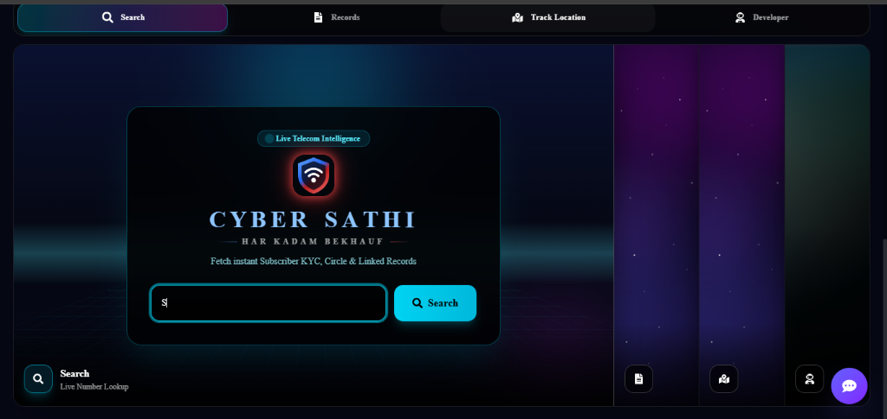
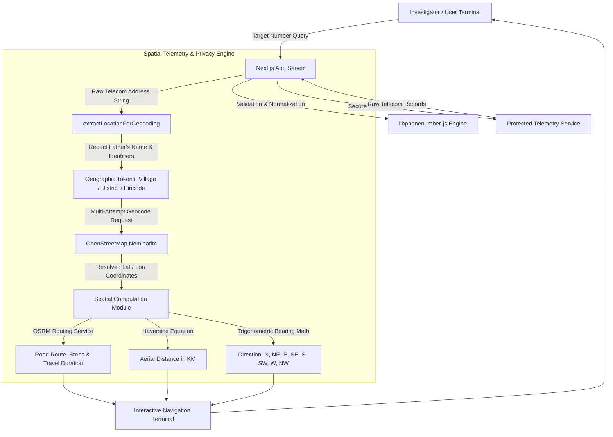

<div align="center">

# 🛡️ CyberSathi
### *Next-Gen Cyber Crime Intelligence, Telemetry Investigation & Victim Assistance Platform*

<br/>

[](https://cybersathii.vercel.app/)
[](https://nextjs.org/)
[](https://react.dev/)
[](https://www.typescriptlang.org/)
[](https://tailwindcss.com/)
[](https://www.openstreetmap.org/)
[](#)

<br/>

<p align="center">
  <b>CyberSathi</b> is a comprehensive cyber crime assistance and real-time telecom intelligence platform engineered to empower investigators and assist cyber victims with precision spatial analysis, caller verification, privacy-filtered geocoding, aerial distance calculation, and emergency incident workflows.
</p>

[🌐 Visit Live Application](https://cybersathii.vercel.app/) • [✨ Core Features](#-core-features) • [🏛️ System Architecture](#-system-architecture) • [🚀 Getting Started](#-getting-started) • [🔐 Security & Privacy](#-security--privacy-architecture) • [📬 Contact](#-developer--support)

<br/>



<br/>

---

</div>

## 📌 Executive Summary

Modern cyber threats—such as financial frauds, OTP extortion schemes, SIM swapping attacks, and social engineering—demand immediate tactical response and accurate spatial telemetry. **CyberSathi** bridges this critical gap by providing a unified incident response and caller intelligence hub:

- ⚡ **Instant Caller Verification**: Decodes telecom circles, operator metadata, and correlated linked subscriber records within seconds.
- 🎯 **Privacy-Preserving Geocoding**: Automatically isolates personal identifiers (e.g., Father's name, individual names, flat/house numbers) to geocode directly to village, tehsil, and district coordinates.
- 🧭 **Aerial & Terrestrial Navigation**: Computes high-precision straight-line distance via the Haversine formula, compass bearings (N, NE, E, SE, S, SW, W, NW), and road routing via OSRM.
- 🚨 **Emergency Victim Protocols**: Actionable guidance for reporting financial theft within the critical "Golden Hour", national 1930 integration, and harassment protection frameworks.

---

## ✨ Core Features

### 1. 🔍 Caller Intelligence & Telecom Telemetry
- **Carrier & Circle Analysis**: Identifies telecom circle, network operator, subscriber metadata, and carrier type.
- **Multi-Record Correlation**: Seamlessly maps primary records against alternate linked connections without client latency.
- **Standardized Number Normalization**: Leverages `libphonenumber-js` for rigorous E.164 compliance and country code validation.

### 2. 🗺️ Precision Spatial Tracing & Location Analytics
- **Identity Redaction Filter**: Strips personal relationship prefixes (such as S/O, D/O, Father's Name) and specific door/flat identifiers to eliminate geocoder confusion.
- **Village & District Level Geocoding**: Queries the OpenStreetMap Nominatim engine to locate accurate coordinates down to Village, Tehsil, District, or State level.
- **Aerial Distance (Haversine Formula)**: Calculates exact straight-line distance (in kilometers) between investigator origin and target telecom location.
- **Compass Bearing Calculation**: Derives 8-point compass bearing directions (`North`, `North-East`, `East`, `South-East`, `South`, `South-West`, `West`, `North-West`).
- **Turn-by-Turn Terrestrial Routing**: Generates road route paths, step-by-step directions, and travel times across Driving, Cycling, and Walking profiles.
- **Deep Navigation Integration**: Embedded interactive mapping with direct 1-click launch into Google Maps navigation.

### 3. 🚨 Cyber Assistance Portal & Help Desk
- **Financial Fraud Protocol**:
  - Immediate standard operating procedures (SOPs) for freezing compromised bank accounts during the crucial "Golden Hour".
  - Structured guidance for lodging official complaints through the National Cyber Crime Portal (`cybercrime.gov.in` / `1930`).
- **Women Safety & Online Harassment Desk**:
  - Legal remedies and evidence documentation checklists for cyber stalking, identity impersonation, and non-consensual content distribution.
- **Direct Emergency Directory**:
  - Searchable emergency contacts, fraud reporting hotlines, and web portals for premier Indian banking and financial institutions.

### 4. 🤖 24/7 Incident Assistant (Chatbot)
- Persistent floating assistance widget available across all views for rapid procedural queries and safety guidelines.

---

## 🏛️ System Architecture



---

## 🛠️ Technology Stack

| Architecture Layer | Technology & Tools |
| :--- | :--- |
| **Frontend Framework** | [Next.js 16](https://nextjs.org/) (App Router, Server & Client Components) |
| **Core UI & Language** | [React 19](https://react.dev/), [TypeScript 5](https://www.typescriptlang.org/) |
| **Styling & Theming** | [Tailwind CSS v4](https://tailwindcss.com/), Motion, tw-animate-css |
| **Component Primitives** | Base UI, Lucide React, React Icons |
| **Phone Parsing** | [libphonenumber-js](https://gitlab.com/catamphetamine/libphonenumber-js) |
| **Geocoding & Spatial Routing** | OpenStreetMap Nominatim, OSRM Routing Engine, Google Maps API |
| **Backend & API Layer** | Next.js Server-Side Route Proxies (Node.js & Edge Runtimes) |

---

## 🚀 Getting Started

### 📋 Prerequisites
- **Node.js**: `v18.18+` (`v20 LTS` recommended)
- **Package Manager**: `npm`, `pnpm`, or `yarn`
- **Git**: Installed and configured

### ⚙️ Installation & Local Setup

1. **Clone Repository**:
   ```bash
   git clone https://github.com/anupam06114s/cybersathi.git
   cd cybersathi
   ```

2. **Install Dependencies**:
   ```bash
   npm install
   ```

3. **Launch Development Server**:
   ```bash
   npm run dev
   ```

4. **Access Portal in Browser**:
   ```text
   http://localhost:3000
   ```

5. **Build for Production**:
   ```bash
   npm run build
   npm run start
   ```

---

## 📁 Repository Directory Structure

```text
cybersathi/
├── public/                 # Static assets, campaign banners & media
│   ├── banners/            # Incident prevention campaigns
│   └── preview.png         # High-resolution application preview
├── src/
│   ├── app/                # Next.js App Router root
│   │   ├── api/            # Server-Side Route Handlers
│   │   │   ├── geocode/    # Multi-pass geographic coordinate resolution
│   │   │   ├── lookup/     # Secure protected caller intelligence proxy
│   │   │   └── route/      # OSRM road distance, duration & step generator
│   │   ├── globals.css     # Tailwind CSS v4 styling & dark theme tokens
│   │   ├── layout.tsx      # Application root layout & metadata configuration
│   │   └── page.tsx        # Unified CyberSathi portal dashboard
│   ├── components/         # Modular React Components
│   │   ├── brand/          # Brand identity, crest & logo assets
│   │   ├── cyber-pidita/   # Crime awareness banners & educational carousel
│   │   ├── help-desk/      # Incident victim portals, banking directory & chatbot
│   │   ├── number-lookup/  # Investigation console & TrackLocationView
│   │   └── ui/             # Accessible UI components & status panels
│   └── lib/                # Algorithmic utilities & mathematical engines
│       ├── phone-lookup.ts # Haversine distance, bearing math & geocoding filters
│       └── utils.ts        # Dynamic class merger utilities
└── package.json            # Package dependencies & build scripts
```

---

## 🔐 Security & Privacy Architecture

- 🛡️ **Zero Direct Upstream Exposure**: Upstream third-party endpoints and credentials remain strictly contained within server-side Next.js route handlers, preventing reverse-engineering from browser network inspect tools.
- 🚫 **Identity Redaction**: Address strings are filtered before geocoding requests to exclude father's names and personal occupant data, protecting privacy and maximizing geocoding resolution.
- ⚡ **Rate-Limiting & Caching**: External spatial API calls incorporate disciplined request gaps and server-level caching headers in strict adherence to OpenStreetMap usage policies.

---

## 👨‍💻 Developer & Support

- **Lead Developer**: Anupam
- **Official Telegram**: [@anupam0611](https://t.me/anupam0611)
- **Live Portal**: [cybersathii.vercel.app](https://cybersathii.vercel.app/)
- **Source Code**: [github.com/anupam06114s/cybersathi](https://github.com/anupam06114s/cybersathi)

---

<div align="center">
  <sub>Engineered to safeguard digital cyberspace and assist victims of cyber crime.</sub>
</div>
