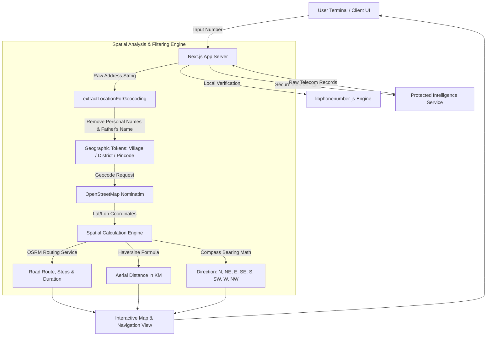

<div align="center">

# 🛡️ CyberSathi (साइबर साथी)
### *Next-Gen Cyber Crime Intelligence, Caller Investigation & Victim Assistance Platform*

[](https://nextjs.org/)
[](https://react.dev/)
[](https://www.typescriptlang.org/)
[](https://tailwindcss.com/)
[](#)

<p align="center">
  <b>CyberSathi</b> ek comprehensive digital cyber crime helpline aur phone intelligence portal hai jo investigative analysis, caller verification, privacy-first geocoding, aerial distance calculation, aur 24/7 victim guidance pradan karta hai.
</p>

[Explore Features](#-core-features) • [System Architecture](#-system-architecture) • [Getting Started](#-getting-started) • [Security & Privacy](#-security--privacy-architecture) • [Contact](#-developer--support)

---

</div>

## 📌 Executive Summary

Modern cyber crimes (Financial fraud, OTP extortion, SIM swap, impersonation, aur blackmailing) me immediate response aur accurate telemetry ki jarurat hoti hai. **CyberSathi** cyber victims aur investigators ke liye ek single unified terminal create karta hai:
- **Instant Intelligence**: Telecom metadata aur circle identity seconds me decode hoti hai.
- **Privacy-Filtered Geocoding**: Father's name aur sensitive personal prefixes ko strip karke direct geographical level (Village/District/Pincode) par trace karta hai.
- **Dynamic Route & Compass Analytics**: Straight-line distance, compass direction, turn-by-turn road route aur live Google Maps navigation.
- **Actionable Victim Emergency Protocols**: Instant steps for frozen bank accounts, 1930 reporting, social media takedowns, aur legal rights.

---

## 🌟 Core Features

### 1. 🔍 Caller Intelligence & Telecom Telemetry
- **Carrier & Circle Analysis**: State telecom circle, operator type, subscriber metadata instantly parse karta hai.
- **Multi-Record Correlation**: Primary records ke sath alternate telecom links ko track karta hai bina system latency ke.
- **Number Normalization**: Global standards (`libphonenumber-js`) se E.164 formatting aur Indian mobile number verification.

### 2. 🗺️ Precision Location Tracing & Spatial Navigation
- **Father's Name & Personal ID Redaction**: Telecom address strings me se personal identity tokens (e.g. S/O, D/O, Father's Name, Flat/House numbers) ko filter karta hai taaki spatial geocoding accurate ho sake.
- **Village & District Level Geocoding**: Nominatim engine dwara specific Village, Tehsil, District aur State coordinates extract karta hai.
- **Straight-Line Distance (Aerial)**: Origin se destination ke beech high-precision Haversine mathematical model se aerial distance calculate karta hai.
- **Compass Bearing & Direction**: Accurate bearing calculation (North, North-East, East, South-East, South, South-West, West, North-West).
- **Road Routing & OSRM Engine**: Driving, cycling, aur walking modes ke liye turn-by-turn steps, road distance aur duration.
- **Interactive Deep Linking**: Real-time embedded Google Maps navigation terminal.

### 3. 🚨 Cyber Pidita (पीड़िता) Portal & Help Desk
- **Financial Fraud Protocol**:
  - UPI/Net Banking fraud par Golden Hour actions (immediate bank frozen steps).
  - Indian Cyber Crime Reporting Portal (1930) reporting framework.
- **Women Safety & Cyber Harassment Support**:
  - Cyber stalking, impersonation, non-consensual image distribution ke khilaf legal remedies aur FIR guidelines.
- **Direct Emergency Directory**:
  - Leading Indian banks ke emergency fraud numbers aur portal URLs ka searchable directory.

### 4. 🤖 24/7 Cyber Assistant (Chatbot)
- Floating emergency chat assistant jo har page par available rehta hai.
- Immediate standard operating procedures (SOPs) aur safety workflows guide karta hai.

---

## 🏗️ System Architecture



---

## 🛠️ Technology Stack

| Layer | Technologies Used |
| :--- | :--- |
| **Frontend Framework** | [Next.js 16](https://nextjs.org/) (App Router, Server & Client Components) |
| **UI Core & React** | [React 19](https://react.dev/), TypeScript 5 |
| **Styling & Design System** | Tailwind CSS v4, Motion (Framer Motion), Tw-Animate-Css |
| **Component Primitives** | Base UI, Lucide React, React Icons |
| **Number Normalization** | libphonenumber-js |
| **Geocoding & Mapping** | OpenStreetMap Nominatim, OSRM Routing, Google Maps Navigation |
| **Backend & API Layer** | Next.js Secure Route Handlers (Edge & Node.js runtimes) |

---

## 🚀 Getting Started

### 📋 Prerequisites
- **Node.js**: v18.18 or higher (v20+ recommended)
- **Package Manager**: `npm`, `pnpm`, or `yarn`
- **Git**: Installed on your system

### ⚙️ Installation & Setup

1. **Repository Clone Karein**:
   ```bash
   git clone https://github.com/anupam06114s/cybersathi.git
   cd cybersathi
   ```

2. **Dependencies Install Karein**:
   ```bash
   npm install
   ```

3. **Development Server Start Karein**:
   ```bash
   npm run dev
   ```

4. **Browser Me Open Karein**:
   ```text
   http://localhost:3000
   ```

5. **Production Build (Optional)**:
   ```bash
   npm run build
   npm run start
   ```

---

## 📁 Repository Directory Structure

```text
cybersathi/
├── public/                 # Static assets, awareness banners & logos
│   └── banners/            # Visual crime prevention campaigns
├── src/
│   ├── app/                # Next.js App Router
│   │   ├── api/            # Secure Server-Side Route Handlers
│   │   │   ├── geocode/    # Multi-pass geographical coordinate resolution
│   │   │   ├── lookup/     # Secure protected caller intelligence service
│   │   │   └── route/      # OSRM road distance, duration & steps
│   │   ├── globals.css     # Tailwind v4 theme & custom utilities
│   │   ├── layout.tsx      # Root application layout & metadata
│   │   └── page.tsx        # CyberSathi unified portal page
│   ├── components/         # Modular React Components
│   │   ├── brand/          # CyberSathi identity & logo assets
│   │   ├── cyber-pidita/   # Crime awareness banners & carousel
│   │   ├── help-desk/      # Victim portals, bank directory & chatbot
│   │   ├── number-lookup/  # Search console, results & TrackLocationView
│   │   └── ui/             # Reusable UI controls
│   └── lib/                # Utility functions & spatial calculation engines
│       ├── phone-lookup.ts # Haversine, bearing math, geocoding filters
│       └── utils.ts        # Class merging & UI utilities
└── package.json            # Project manifest & dependencies
```

---

## 🔒 Security & Privacy Architecture

- 🛡️ **Zero Direct Upstream Exposure**: Client browser kabhi bhi direct external endpoints ko access nahi karta; saari data handling Next.js server-side route proxies ke zariye secure rehti hai.
- 🚫 **Identity Redaction**: Location tracing module Father's Name ya kisi vyakti ke personal residential address ke exact flat numbers ko isolate karta hai, taaki privacy leak na ho aur geocoding failure eliminate ho sake.
- ⚡ **Rate-Limiting & Caching**: Public geocoding protocols OpenStreetMap Fair Use policy ka samman karte hue intelligent request gaps aur server-level caching follow karte hain.

---

## 👨‍💻 Developer & Support

- **Lead Developer**: Anupam
- **Official Telegram**: [@anupam0611](https://t.me/anupam0611)
- **GitHub Repository**: [anupam06114s/cybersathi](https://github.com/anupam06114s/cybersathi)

---

<div align="center">
  <sub>Built with ❤️ to safeguard Indian cyberspace and support digital crime victims.</sub>
</div>
